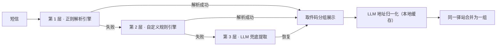

# 自邮取


查快递、取快递用的 Android 应用。接了快递100 API，输入单号就能查。快递到了会推通知，取件码从短信里自动提取。可选接入大模型，让取件码识别更准、分组更聪明。

## 功能

**查快递**
- 输入单号查询，自动识别快递公司（支持 3050 家）
- 批量查询，一次查多个
- 未签收、已签收、全部三个列表
- 物品备注，方便区分包裹
- 删除的快递进回收站，能恢复

**取件码**
- 自动读取短信里的取件码，按驿站地址分组
- 标记已取后可隐藏
- 一键生成「到站一次性取完」的取件清单
- 一键跳转淘宝/拼多多身份码
- 支持自定义解析规则，处理格式特殊的短信
- 取件超过 72 小时没取，后台提醒你

**大模型增强**（可选，自己填 API Key）
- 驿站地址归一化：「临江南区菜鸟驿站」和「临江大学南区菜鸟驿站」是同一个地方？自动合并成一组
- 失败短信兜底提取：正则认不出的短信，大模型帮忙把取件码捞出来
- 送达估算：详情页显示「预计 X 日送达（估算）」
- 接入方式 OpenAI 兼容可配置，DeepSeek / 硅基流动 / 本地 Ollama 都能用

**界面**
- Telegram 风格动画：页面转场、列表入场、按压反馈
- 浅色/深色模式，跟随系统或手动切换
- 自定义底部导航栏，切换 tab 有动画

**其他**
- 打开 app 自动刷新，签收弹通知
- 检测到新版本会提示更新
- 30 天自动清理旧记录

## 短信识别：三层架构

取件码识别不是单点方案，而是三层递进，兼顾速度、可控性和准确率：



- 第 1 层是自研正则引擎（`lib/utils/sms_parser.dart`），毫秒级、离线、零成本，处理绝大多数标准格式；
- 第 2 层允许你自己加解析规则，对付格式刁钻的短信；
- 第 3 层把前两层都认不出的短信批量交给大模型提取，认不出就认不出，**绝不编造**。
- 归一化结果永久缓存：同一个驿站一辈子只问一次大模型，之后离线生效。

任何一层坏了都不影响上一层——大模型只是增强，没配置、没网络、接口挂了，app 照常用。

## 评测基准

`benchmark/` 目录是一套可复现的评测：136 条脱敏标注短信（含负样本和分组真值）+ 一键评测脚本。真实模型实测：

| 指标 | 正则引擎 | + LLM 兜底/归一化 |
|---|---|---|
| 精确识别率（取件码+地址全对） | 58.1% | **91.9%** |
| 驿站分组 pairwise F1 | 59.6% | **95.0%** |
| 同站被拆成几组（真实 6 组） | 21 组 | 13 组 |
| LLM 调用成本 | — | 4 批请求 |

```bash
dart run benchmark/eval_runner.dart          # 离线，无需 Key
dart run benchmark/eval_runner.dart --llm    # 带 LLM 对照
```

数据集、指标定义、分类分解见 [benchmark/README.md](benchmark/README.md)。

## 使用

1. 去 [快递100 API](https://api.kuaidi100.com) 注册，拿到 Key 和 Customer
2. 打开 app，"我的"页面填入 Key 和 Customer
3. "查快递"页面输入单号查询
4. 快递列表页下拉刷新
5. （可选）"我的 → 大模型"里填入模型服务地址和 API Key，启用 AI 增强

**小米手机**需要额外开启"通知类短信"权限才能读取取件码短信：

系统设置 → 应用管理 → 自邮取 → 开启"通知类短信"

## 构建

```bash
flutter pub get
flutter test
flutter build apk --release
```

- Flutter 3.29.3（其他版本未验证；`workmanager` 请保持 `^0.7.0`，0.8+ 需要更高版本 Flutter）
- release 构建需要 `keystore.properties`（签名配置，模板见 `android/app/build.gradle.kts` 中的读取逻辑），**不要把密钥提交进仓库**

## 隐私

- 所有数据存手机本地（Hive + SharedPreferences），没有自己的服务器
- 大模型增强只发送：驿站地址、取件码、短信内容、快递公司与轨迹文本
- **绝不发送**：手机号、快递单号、快递100 API Key、身份信息
- API Key 由你自己填写、自己保管

## 技术栈

| 用途 | 方案 |
|------|------|
| 框架 | Flutter 3.x |
| 状态管理 | Riverpod |
| 网络 | dio |
| 存储 | Hive + SharedPreferences |
| 通知 | flutter_local_notifications |
| 短信 | flutter_sms_inbox |
| 后台任务 | workmanager |
| 大模型接入 | OpenAI 兼容接口（可配置） |

## 项目结构

```
lib/
├── main.dart            # 启动注入、导航、页面转场
├── animations/          # 动画工具（页面转场、列表动画、导航栏）
├── config/              # 主题、常量
├── models/              # 数据模型
├── services/            # API、存储、通知、LLM、后台任务
├── providers/           # 状态管理
├── screens/             # 页面
├── widgets/             # 组件
└── utils/               # 签名、短信解析、LLM prompts、地址归一化、兜底提取
benchmark/               # 评测基准（数据集 + 评测脚本）
test/                    # 测试
```

## 开源资源与许可

本项目基于 Flutter / Riverpod / dio / Hive / WorkManager 等开源组件构建（完整清单及许可义务见技术报告附件《开源及第三方资源使用清单》）。快递查询依赖[快递100 开放 API](https://api.kuaidi100.com)（服务条款以其官方为准）；大模型增强使用你自己配置的模型服务。

## 维护

- 提交规范：`feat:` / `fix:` / `style:` / `docs:` / `chore:` 前缀
- 版本号三处同步：`pubspec.yaml`、`update_service.dart`、`mine_screen.dart`
- 更新日志见 [CHANGELOG.md](CHANGELOG.md)
- 欢迎提 Issue / PR；评测数据集接受补充样本（用 `--audit` 自查标注质量）
